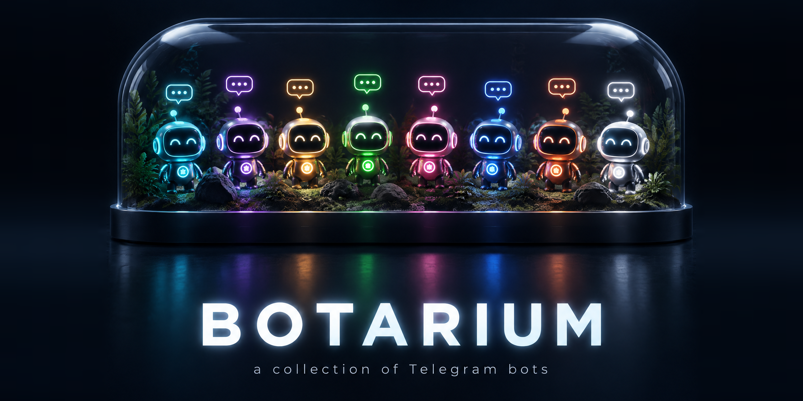
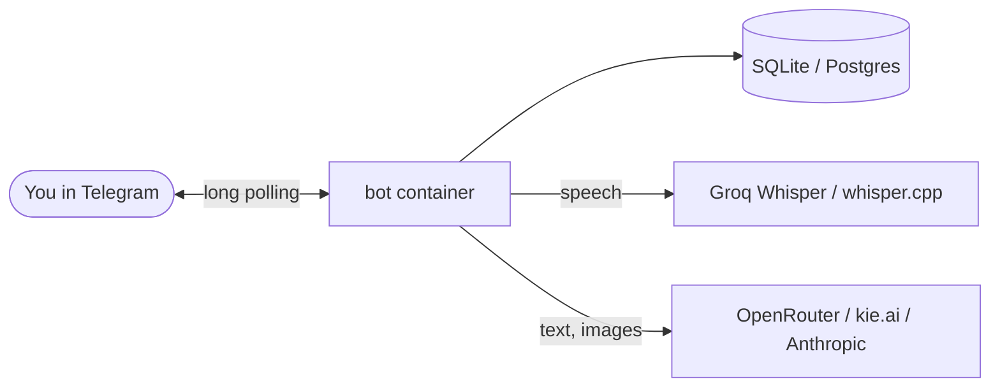

<p align="center">
  
</p>

<h1 align="center">Botarium</h1>

<p align="center"><b>Eight ready-to-run Telegram bots in one repo - voice summaries, tasks, reminders, image generation, booking, alerts and health reports. One <code>docker compose</code> service per bot.</b></p>

<p align="center">
  
  
  
  
  
  
</p>

<p align="center">
  <a href="#quick-start">Quick start</a> ·
  <a href="#the-bots">The bots</a> ·
  <a href="#how-it-works">How it works</a> ·
  <a href="README.ru.md">Русский</a>
</p>

---

## The bots

| Bot | What it does | Stack | Example |
|---|---|---|---|
| 🎙 [**voice-summarizer**](bots/voice-summarizer) | Voice message in, structured summary out; "story" sessions with a named speaker | Python, Groq Whisper, OpenRouter | `[voice 2 min]` → *"Key points: delivery moves to Friday; budget unchanged"* |
| ✅ [**taskflow**](bots/taskflow) | Task manager: projects, deadlines, invites, recurring tasks, voice input, AI task analysis | Python, PostgreSQL, whisper.cpp, OpenRouter | `[voice]` *"invoice by Thursday, high priority"* → task with deadline |
| 😡 [**grumpy-reminder**](bots/grumpy-reminder) | Natural-language reminders that nag, escalate and swear until you tick them off | Python, APScheduler, SQLite | *"remind me at 9 to call the bank"* → loud ping at 09:00, +5, +10 min |
| 🍌 [**banana-studio**](bots/banana-studio) | Generate, edit and restyle images with Nano Banana; daily limits, tiers, admin panel | Python, aiohttp, kie.ai | *"corgi astronaut, film still"* → image + ratio buttons |
| 💅 [**salon-booking**](bots/salon-booking) | AI receptionist that books appointments by text or voice | Python, SQLite, OpenRouter | *"manicure with Maria tomorrow at 2?"* → collects name/phone, books |
| 🍳 [**chef-roast**](bots/chef-roast) | Recipe bot with the temper of an angry TV chef, with a food-safety filter | Node.js, Telegraf, SQLite | *"eggs, tomatoes, stale bread"* → a recipe, shouted |
| 🛡 [**air-alert-radar**](bots/air-alert-radar) | Air-threat alerts for your area from several public sources, de-duplicated and ranked by distance | Python (stdlib only) | 🔴 *"UAV - your district"* with map / mute buttons |
| ❤️ [**health-monitor**](bots/health-monitor) | Morning health score from a Mi Band export, analysed by Claude | Python, Gadgetbridge, Anthropic API | *"Overall: 78% - Good. Sleep 7h10, resting HR 58..."* |

> [!NOTE]
> Most bots speak **Russian** (prompts, buttons, replies). The code and configuration are in English; translating a bot
> means editing its prompts and string constants.

## Why

Every bot here started as a tool somebody actually used. They are small enough to read in an evening, wired the same
way (`.env` → `docker compose`), and free of secrets and personal IDs - a practical starting point for your own bot
instead of another "hello world" tutorial.

## Features

- 🐳 **One command per bot** - a Compose service and `.env.example` for each
- 🔐 **No inbound ports** - every bot uses long polling; nothing listens on your server
- 🧩 **Independent** - run one bot or all eight; each folder works on its own
- 🧠 **LLM-ready** - OpenRouter, Groq Whisper, kie.ai, Anthropic wired through env vars
- 🗄 **Real storage** - SQLite per bot, PostgreSQL for TaskFlow (schema applied automatically)

## Quick start

Requirements: Docker with Compose v2.24+ and a bot token from [@BotFather](https://t.me/BotFather) per bot.

```bash
git clone https://github.com/meshoklv/botarium && cd botarium
cp bots/voice-summarizer/.env.example bots/voice-summarizer/.env   # add your keys
docker compose up -d --build voice-summarizer
```

Swap `voice-summarizer` for any service name: `taskflow`, `grumpy-reminder`, `banana-studio`, `salon-booking`,
`chef-roast`, `air-alert-radar`, `health-monitor`. Without Docker, each bot's README has a plain `python bot.py` /
`npm start` path.

> [!WARNING]
> Tested here: Python bots import cleanly with their pinned dependencies, `chef-roast` installs with `npm ci` and its
> modules load, `air-alert-radar` geo/threat classification was exercised offline. **Not tested:** the Docker images and
> Compose file (no Docker on the build host), and nothing was run against the live Telegram API.

## How it works



Each bot is a small standalone program that polls Telegram, keeps its state in a local database volume, and calls
the AI providers you configure. `docker-compose.yml` simply builds `bots/<name>` into one service each.

## Configuration

Every bot reads its own `bots/<name>/.env` (see the `.env.example` next to it). Common variables:

| Variable | Used by | Meaning |
|---|---|---|
| `TELEGRAM_BOT_TOKEN` | all but air-alert-radar, health-monitor | token from @BotFather |
| `OUTER_API_KEY` / `OPENROUTER_API_KEY` | voice, reminder, salon, taskflow, chef | OpenRouter key |
| `GROQ_API_KEY` | voice, reminder, salon | Whisper speech-to-text |
| `KIE_API_KEY` | banana-studio | image generation |
| `ADMIN_USER_ID` / `CHAT_ID` / `ADMIN_ID` | banana, health, radar | your numeric Telegram id |
| `ALLOWED_USER_IDS` | voice-summarizer | restrict the bot to listed users |

## Security

- Bots only make outbound connections; Compose publishes no ports.
- Keep `.env` files out of git (they are in `.gitignore`). Never paste tokens into issues.
- `voice-summarizer`, `salon-booking`, `chef-roast` are open to anyone who finds the bot and spend **your** API quota -
  use `ALLOWED_USER_IDS` or revoke the token if abused.
- `health-monitor` sends health data to the Anthropic API; `air-alert-radar` relies on unofficial sources.

## Contributing

PRs and issues are welcome - see [CONTRIBUTING.md](CONTRIBUTING.md).

## License

[MIT](LICENSE)

---

<p align="center">Made by <a href="https://github.com/meshoklv">@meshoklv</a></p>
