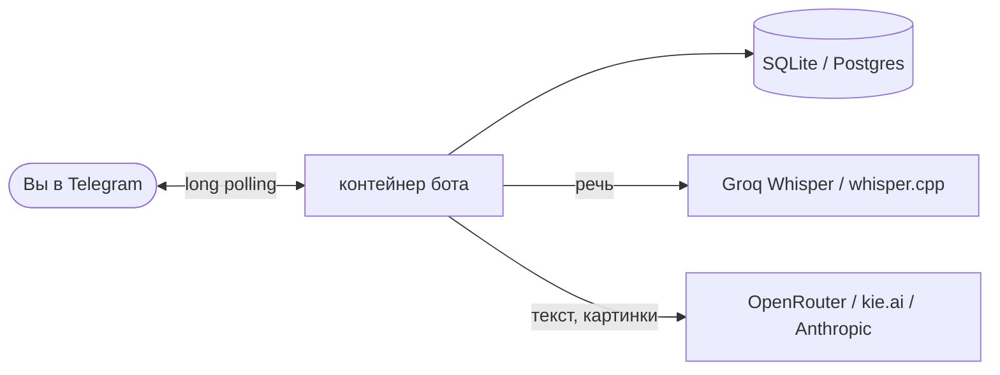

<p align="center">
  
</p>

<h1 align="center">Botarium</h1>

<p align="center"><b>Восемь готовых Telegram-ботов в одном репозитории: голосовые выжимки, задачи, напоминалки, генерация картинок, запись, оповещения и отчёты о здоровье. Один сервис <code>docker compose</code> на каждого бота.</b></p>

<p align="center">
  
  
  
  
  
  
</p>

<p align="center">
  <a href="#быстрый-старт">Быстрый старт</a> ·
  <a href="#боты">Боты</a> ·
  <a href="#как-это-устроено">Как устроено</a> ·
  <a href="README.md">English</a>
</p>

---

## Боты

| Бот | Что делает | Стек | Пример |
|---|---|---|---|
| 🎙 [**voice-summarizer**](bots/voice-summarizer) | Из голосового делает структурированную выжимку; режим «история» с именем рассказчика | Python, Groq Whisper, OpenRouter | `[голосовое 2 мин]` → *«Главное: поставка в пятницу, бюджет прежний»* |
| ✅ [**taskflow**](bots/taskflow) | Менеджер задач: проекты, дедлайны, приглашения, повторяющиеся задачи, голосовой ввод, ИИ-разбор задачи | Python, PostgreSQL, whisper.cpp, OpenRouter | `[голос]` *«счёт до четверга, важно»* → задача с дедлайном |
| 😡 [**grumpy-reminder**](bots/grumpy-reminder) | Напоминания обычной речью: злится, эскалирует и ругается, пока не отметишь выполненным | Python, APScheduler, SQLite | *«напомни в 9 позвонить в банк»* → пинки в 09:00, +5, +10 мин |
| 🍌 [**banana-studio**](bots/banana-studio) | Генерация, правка и перенос стиля картинок через Nano Banana; лимиты, тарифы, админка | Python, aiohttp, kie.ai | *«корги-космонавт, кадр из фильма»* → картинка и кнопки форматов |
| 💅 [**salon-booking**](bots/salon-booking) | ИИ-администратор салона: запись текстом или голосом | Python, SQLite, OpenRouter | *«маникюр к Марии завтра в два?»* → спросит имя и телефон, запишет |
| 🍳 [**chef-roast**](bots/chef-roast) | Рецепты от злого шефа, с фильтром безопасности продуктов | Node.js, Telegraf, SQLite | *«яйца, помидоры, чёрствый хлеб»* → рецепт, но криком |
| 🛡 [**air-alert-radar**](bots/air-alert-radar) | Оповещения о воздушной опасности по вашему району из нескольких открытых источников, с дедупликацией и ранжированием по расстоянию | Python (только stdlib) | 🔴 *«БПЛА — ваш район»* с кнопками карты и тишины |
| ❤️ [**health-monitor**](bots/health-monitor) | Утренняя оценка здоровья по выгрузке Mi Band, анализ через Claude | Python, Gadgetbridge, Anthropic API | *«Общее состояние: 78% — хорошо. Сон 7ч10, пульс покоя 58…»* |

> [!NOTE]
> Боты общаются **по-русски** (промпты, кнопки, ответы). Код и конфиги — на английском; чтобы перевести бота, правьте его
> промпты и строковые константы.

## Зачем

Каждый бот родился как рабочий инструмент. Они достаточно малы, чтобы прочитать за вечер, запускаются одинаково
(`.env` → `docker compose`) и очищены от секретов и личных ID — удобная заготовка для собственного бота вместо
очередного «hello world».

## Возможности

- 🐳 **Одна команда на бота** — свой сервис Compose и `.env.example`
- 🔐 **Нет входящих портов** — боты работают через long polling, сервер ничего не слушает
- 🧩 **Независимость** — запускайте одного бота или всех; каждая папка работает сама по себе
- 🧠 **Готовы к LLM** — OpenRouter, Groq Whisper, kie.ai, Anthropic подключаются переменными окружения
- 🗄 **Настоящее хранилище** — SQLite у каждого, PostgreSQL у TaskFlow (схема применяется автоматически)

## Быстрый старт

Нужны: Docker с Compose v2.24+ и токен от [@BotFather](https://t.me/BotFather) на каждого бота.

```bash
git clone https://github.com/meshoklv/botarium && cd botarium
cp bots/voice-summarizer/.env.example bots/voice-summarizer/.env   # впишите ключи
docker compose up -d --build voice-summarizer
```

Вместо `voice-summarizer` подставьте любой сервис: `taskflow`, `grumpy-reminder`, `banana-studio`, `salon-booking`,
`chef-roast`, `air-alert-radar`, `health-monitor`. Без Docker — в README каждого бота есть путь через `python bot.py` / `npm start`.

> [!WARNING]
> Проверено: Python-боты импортируются с закреплёнными зависимостями, `chef-roast` ставится через `npm ci` и его модули
> загружаются, классификация в `air-alert-radar` прогнана офлайн. **Не проверено:** Docker-образы и Compose-файл (на машине
> сборки нет Docker) и работа с живым Telegram API.

## Как это устроено



Каждый бот — небольшая автономная программа: опрашивает Telegram, хранит состояние в томе с локальной базой и
обращается к ИИ-провайдерам, которых вы настроили. `docker-compose.yml` просто собирает `bots/<имя>` в отдельные сервисы.

## Настройка

Каждый бот читает свой `bots/<имя>/.env` (шаблон `.env.example` рядом). Общие переменные:

| Переменная | Кому нужна | Смысл |
|---|---|---|
| `TELEGRAM_BOT_TOKEN` | все, кроме air-alert-radar и health-monitor | токен от @BotFather |
| `OUTER_API_KEY` / `OPENROUTER_API_KEY` | voice, reminder, salon, taskflow, chef | ключ OpenRouter |
| `GROQ_API_KEY` | voice, reminder, salon | распознавание речи Whisper |
| `KIE_API_KEY` | banana-studio | генерация картинок |
| `ADMIN_USER_ID` / `CHAT_ID` / `ADMIN_ID` | banana, health, radar | ваш числовой Telegram id |
| `ALLOWED_USER_IDS` | voice-summarizer | ограничить бота списком пользователей |

## Безопасность

- Боты только исходящие соединения; Compose не публикует портов.
- Не коммитьте `.env` (он в `.gitignore`), не вставляйте токены в issues.
- `voice-summarizer`, `salon-booking`, `chef-roast` доступны любому, кто найдёт бота, и тратят **вашу** квоту API —
  используйте `ALLOWED_USER_IDS` или отзовите токен при злоупотреблении.
- `health-monitor` отправляет данные о здоровье в Anthropic API; `air-alert-radar` опирается на неофициальные источники.

## Участие

PR и issues приветствуются — см. [CONTRIBUTING.md](CONTRIBUTING.md).

## Лицензия

[MIT](LICENSE)

---

<p align="center">Сделал <a href="https://github.com/meshoklv">@meshoklv</a></p>
